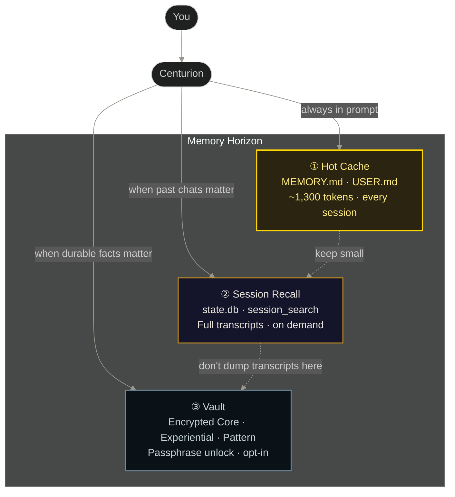
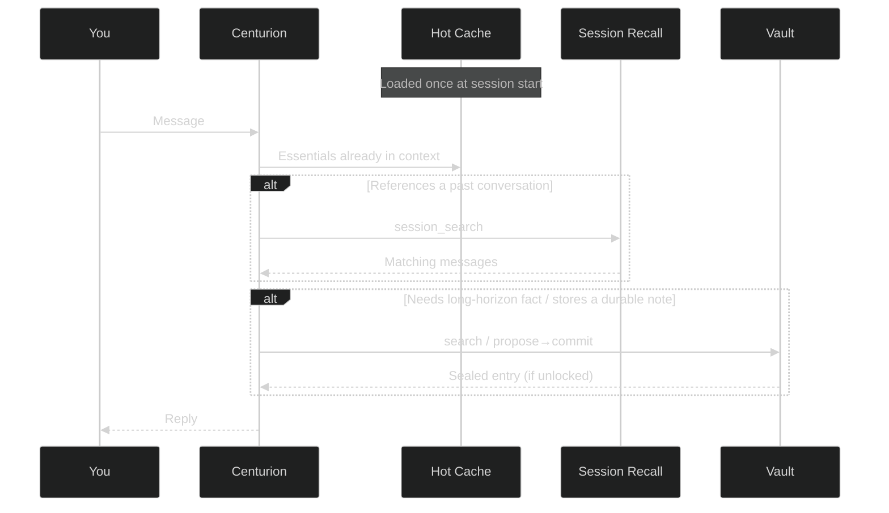

# Memory Horizon

**Memory Horizon** is how Centurion remembers — three layers that stretch from always-on essentials to sealed long-term archives. Not one opaque blob. Not cloud sync. Local, deliberate, and designed so each layer has one job.



### How a turn reaches across the horizon



## At a glance

| Horizon | What it is | When it's used | You manage it |
|---------|------------|----------------|---------------|
| **① Hot Cache** | `MEMORY.md` + `USER.md` (~1,300 tokens total) | **Every session** — frozen into the system prompt at start | Agent curates via the `memory` tool; you can ask it to remember or forget |
| **② Session Recall** | Full transcript history in `~/.centurion/state.db` | **On demand** — when something from a past chat matters | Automatic storage; agent uses `session_search` to find it |
| **③ Vault** | Encrypted Core / Experiential / Pattern entries | **Deliberately** — long-horizon facts the hot cache cannot hold | Opt-in: `centurion vault init`, unlock, `vault.enabled: true` |

:::tip Day to day
Most users live on **Hot Cache + Session Recall** without configuring anything. Open **Vault** when you want sealed, offline archives that outgrow the tiny always-on card.
:::

---

## ① Hot Cache (always on)

**Files:** `~/.centurion/memories/MEMORY.md` and `USER.md`

The near horizon — a **wallet card** of facts in every session:

- **MEMORY.md** — environment, projects, conventions, lessons learned (~2,200 chars)
- **USER.md** — your preferences, style, identity (~1,375 chars)

The agent adds, replaces, and removes entries with the `memory` tool. Content is scanned for injection patterns before it is saved.

**Frozen snapshot:** Captured once at session start; mid-session writes hit disk immediately but refresh the prompt on the **next** session (keeps prompt caching warm).

→ Full details: [Persistent Memory](./memory.md)

---

## ② Session Recall (on demand)

**Store:** `~/.centurion/state.db` (SQLite + FTS5)

The mid horizon — every CLI and messaging conversation, searchable with `session_search`:

- "Did we discuss the migration last week?"
- Scroll forward/backward inside a found session
- No extra LLM cost for search (FTS5 keyword lookup)

Unlimited capacity, **never** stuffed into every prompt. The agent reaches here when past context is relevant.

→ Full details: [Sessions](../sessions.md#session-search-tool)

---

## ③ Vault (opt-in, encrypted)

**Path:** `{CENTURION_HOME}/vault/` (profile-safe)

The far horizon — **offline sealed long-term memory**. AES-256-GCM at rest, passphrase unlock, no cloud sync:

| Type | Use for |
|------|---------|
| `core` | Stable facts and preferences that outgrew the hot cache |
| `experiential` | Significant events and decisions |
| `pattern` | Recurring workflows ("when X, do Y") |

Writes are always **propose → commit**. Vault never auto-ingests full transcripts (use Session Recall for that). Secrets and transcript dumps are rejected at ingest.

**Default:** `vault.enabled: false`.

```bash
centurion vault init
centurion vault unlock
```

```yaml
# ~/.centurion/config.yaml
vault:
  enabled: true
  prefetch_on_turn: false   # optional per-turn recall; off by default
```

→ Full details: [Vault](./vault.md)

---

## Which horizon for what?

| You want to… | Use |
|--------------|-----|
| Remember a preference or project fact for every chat | **Hot Cache** — `memory` / `user` |
| Find what you said in a conversation two weeks ago | **Session Recall** — `session_search` |
| Archive a durable decision, workflow, or life context for years | **Vault** — `core` / `experiential` / `pattern` |
| Store an API key or credential | **None** — use secrets / env; Memory Horizon layers block credential patterns |

**Division of labor:** Keep Hot Cache **small and essential**. Use Session Recall for **historical chat lookup**. Use Vault for **long-horizon archives**.

---

## Optional: external memory providers

Plugins such as Honcho, Mem0, or OpenViking add a **separate** cross-session recall surface. They run **alongside** Memory Horizon — never replacing the Hot Cache.

→ [Memory Providers](./memory-providers.md)

---

## Related

- [Persistent Memory](./memory.md) — Hot Cache in depth
- [Vault](./vault.md) — Vault setup and threat model
- [Sessions](../sessions.md) — Session Recall and session management
- [Configuration](../configuration.md) — `memory:` and `vault:` config keys
